<p align="center">
  
</p>

<h1 align="center">Certificados en Cadena</h1>

<p align="center">
  Constancias de la UANL registradas en Polkadot. El organizador las emite desde la Polkadot App,
  cada estudiante pide la suya por su nombre y cualquiera puede verificarla, también años después.
</p>

<p align="center">
  <a href="https://constancias-uanl.dev-dot.li/"></a>
  <a href="https://certificados-uanl.vercel.app"></a>
  
  <a href="https://github.com/w3nerick/certificados-uanl/actions/workflows/ci.yml"></a>
  
</p>

<p align="center">
  <a href="https://constancias-uanl.dev-dot.li/"><b>Abrir la app</b></a> ·
  <a href="#recorrido">Recorrido</a> ·
  <a href="#cómo-funciona-por-dentro">Cómo funciona por dentro</a> ·
  <a href="#publicar-una-versión-nueva">Publicar</a>
</p>

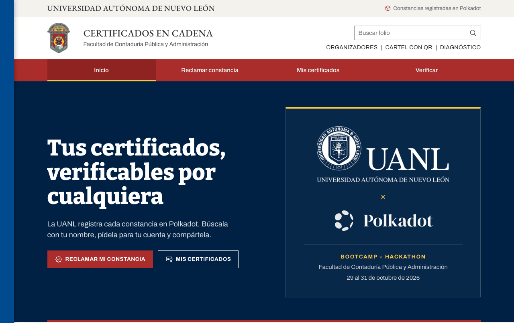

> **Aplicación con fines educativos.** Se hizo para el Bootcamp + Hackathon Polkadot × UANL en la Facultad de
> Contaduría Pública y Administración (29 al 31 de octubre de 2026).

- **App:** `constancias-uanl.dot` en la Polkadot App y Polkadot Desktop · https://constancias-uanl.dev-dot.li
- **Web permanente y relayer:** https://certificados-uanl.vercel.app
- **Contrato:** `RegistroCertificados` en Asset Hub del Products Devnet (`0x5e122d6822e57b943ae964d0d345bd924ac44607`)

## Contenido

- [Recorrido](#recorrido): cada pantalla, paso a paso, y qué pasa por dentro en cada una
- [Cómo funciona por dentro](#cómo-funciona-por-dentro): diagramas de emisión, solicitud y verificación
- [Estructura](#estructura) · [Comandos](#comandos) · [Publicar una versión nueva](#publicar-una-versión-nueva) · [Licencia](#licencia)

## Recorrido

Las capturas son de la versión publicada. Para no mostrar datos de estudiantes se usa el folio de prueba #1
(«Prueba Técnica», un PDF sin validez) y se taparon los nombres reales.

| Quién | Dónde | Qué hace |
|---|---|---|
| Estudiante | Reclamar constancia (`#/constancia`) en la Polkadot App | Conecta su cuenta, escribe su nombre y toca «Es mía». No necesita saldo. |
| Organizador | Panel del organizador (`#/organizar`) en Polkadot Desktop | Emite las constancias desde los PDF de la UANL y aprueba quién se lleva cada una. |
| Cualquiera | Página del folio (`#/c/<folio>`) y Verificar (`#/verificar`) | Ve la constancia y comprueba que el PDF es el registrado. |

### 1. Abrir la app

En la Polkadot App o en Polkadot Desktop se busca `constancias-uanl.dot`. El host baja la app de Bulletin
(el almacenamiento de Polkadot) y la abre con la cuenta del usuario conectada. En un navegador común funciona
la misma app en https://constancias-uanl.dev-dot.li.

<p align="center">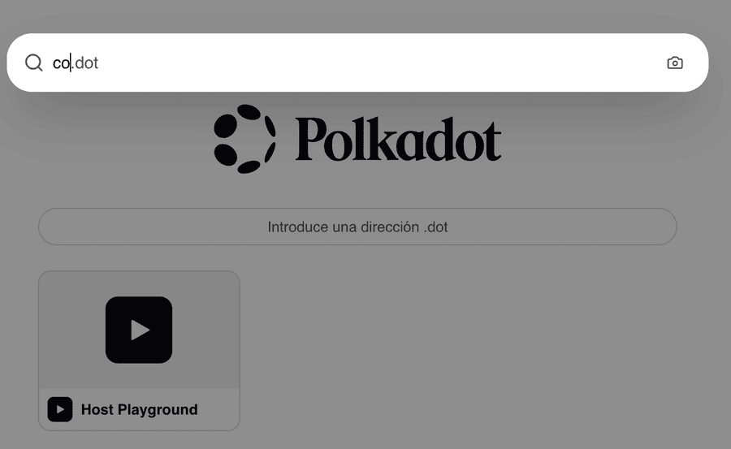</p>

### 2. Reclamar mi constancia (estudiante)

**Paso 1, tu cuenta.** Dentro de la Polkadot App basta con «Conectar mi cuenta de Polkadot App». En un navegador
se escribe el usuario (por ejemplo `ana.01`): la app lo busca en People chain y obtiene la cuenta dueña de ese
usuario. Ahí quedará la constancia.

**Paso 2, tu nombre.** Se escribe el nombre completo tal como aparece en la constancia, sin importar acentos ni
mayúsculas. La app lee del contrato todas las constancias que aún no tienen titular y muestra las que coinciden,
**con su PDF original**.

<p align="center">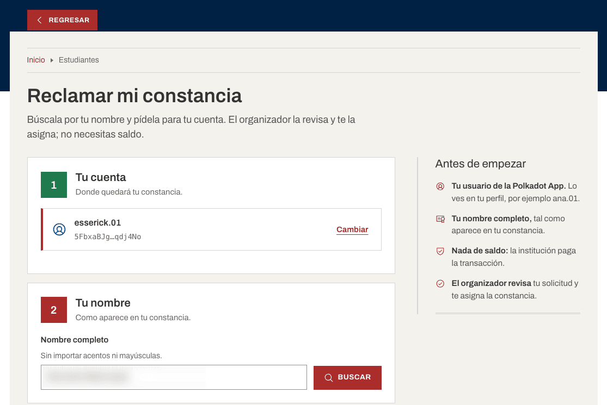</p>

**«Es mía, pedirla».** La app manda la solicitud a `/api/solicitar` (Vercel). El relayer simula la llamada y la
envía al contrato: `solicitar(folio, cuenta, usuario)`. El relayer **paga la comisión** pero **no tiene permisos**
en el contrato. Pedir no asigna nada: el organizador revisa primero.

<p align="center">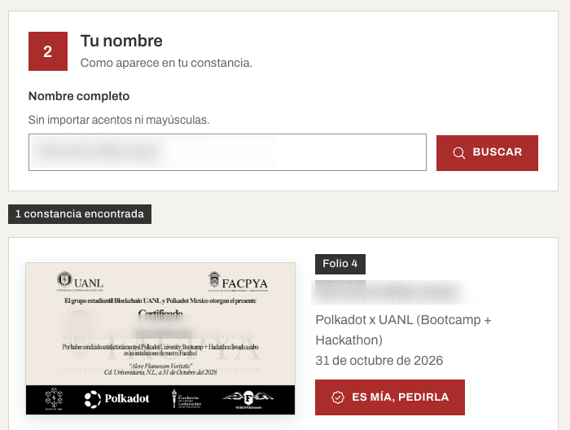</p>

### 3. Panel del organizador (Polkadot Desktop)

**Conectar.** La primera vez el host pregunta si la app puede ver las cuentas registradas. La app comprueba en el
contrato que la cuenta del organizador sea **emisora** (`emisores(cuenta)`).

<p align="center">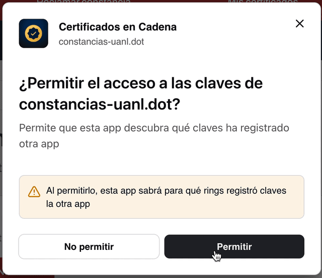</p>

**Emitir.** El organizador elige los PDF de la UANL; el nombre de cada estudiante sale del nombre del archivo.
La app calcula el `sha256` de cada PDF, firma una vez una sesión de subida y `/api/subida` le da un link firmado de
Pinata por PDF (la llave de Pinata nunca llega a la app). Con los CID de IPFS arma lotes de hasta 5, los simula y
el organizador aprueba cada lote en su teléfono: `emitir(lote)`.

**Aprobar solicitudes.** Por cada constancia pedida se ve quién la pidió y si su usuario está **verificado**
(en People chain, ese usuario es dueño de esa cuenta). Al tocar «Aprobar seleccionadas», el host muestra la firma
de la transacción (`Revive.call` al contrato, `asignar(folios, cuentas)`) y se aprueba en el teléfono.

<p align="center">
  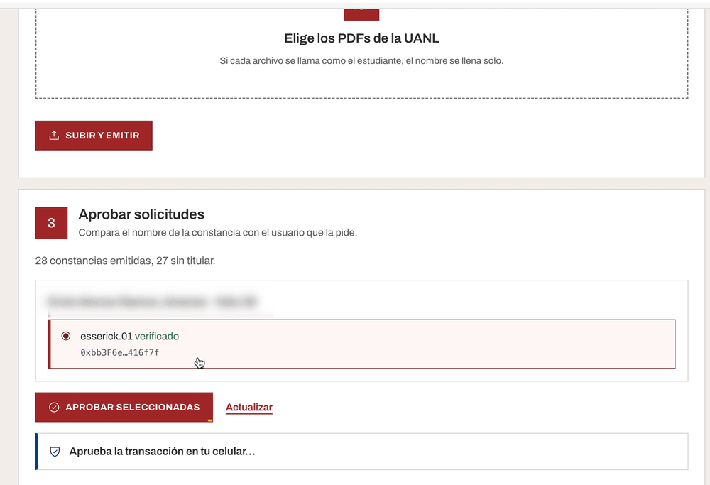
  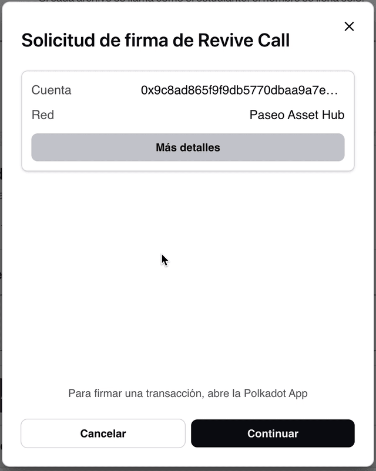
</p>

### 4. Mis certificados

Las constancias asignadas a la cuenta, cada una con su PDF original. Dentro de la Polkadot App se usa la cuenta
conectada; en un navegador se busca por usuario o dirección. También avisa si hay una solicitud esperando
aprobación.

<p align="center">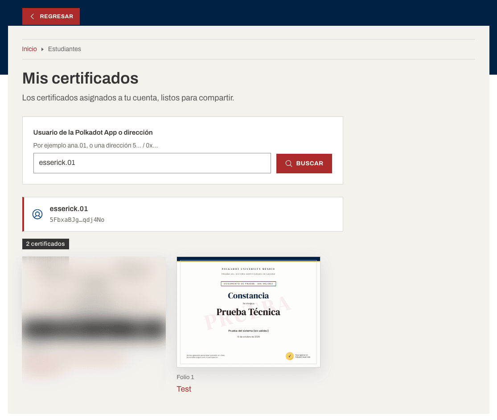</p>

### 5. La página del certificado

Lo que se comparte. Todo sale de la cadena: nombre, programa, fecha, quién la emitió y en qué bloque, si ya tiene
titular y si fue revocada. El **PDF original** se baja de IPFS y su huella `sha256` se compara con la registrada
(«PDF íntegro»). Desde aquí se descarga el PDF, se agrega a LinkedIn, se copia el enlace o se muestra un QR para
abrirla en otro celular.

<p align="center">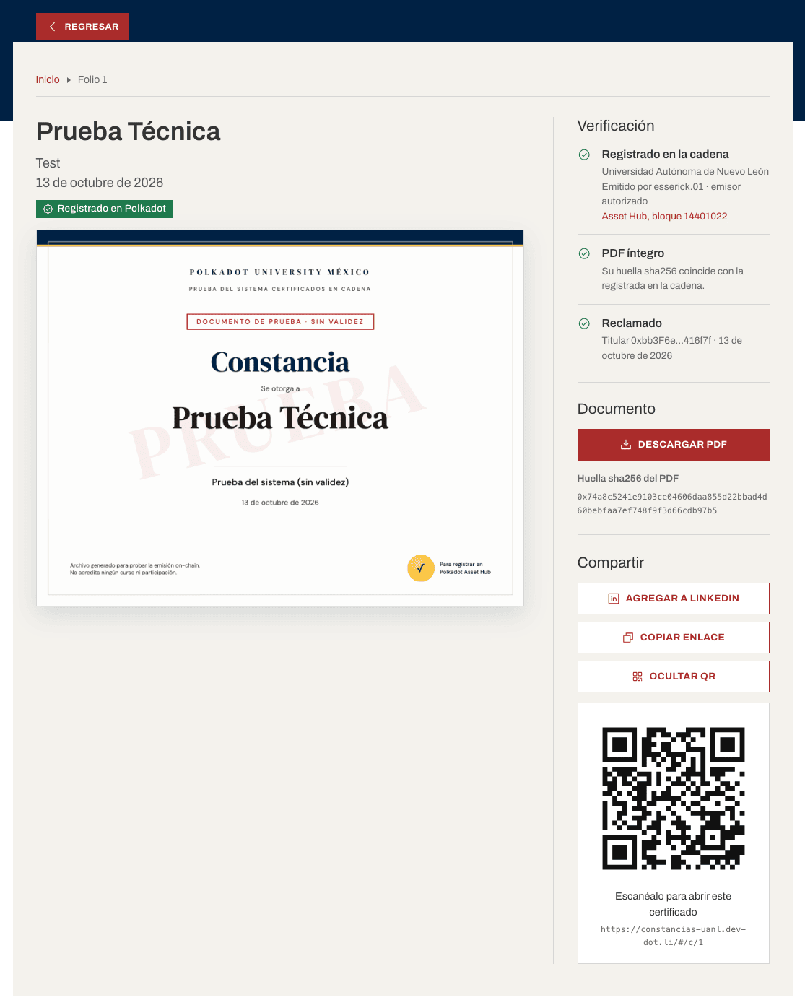</p>

### 6. Verificar un PDF

Para quien recibe una constancia: suelta el PDF y la app calcula su huella **en el dispositivo** (el archivo no se
sube a ningún lado), la busca en el contrato (`porPdf`) y dice si es auténtica, de qué folio es y si sigue vigente.
También se puede buscar por número de folio.

<p align="center">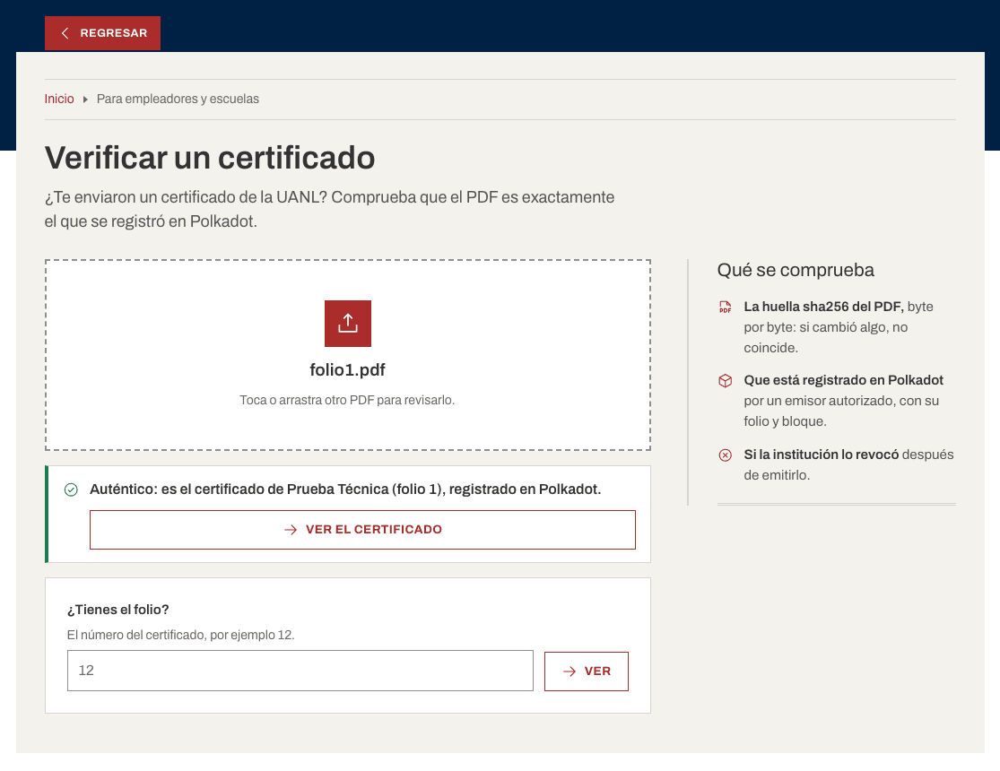</p>

### 7. Cartel con QR

Un A4 listo para imprimir o proyectar en el evento, con el QR a la app y los tres pasos para reclamar.

<p align="center">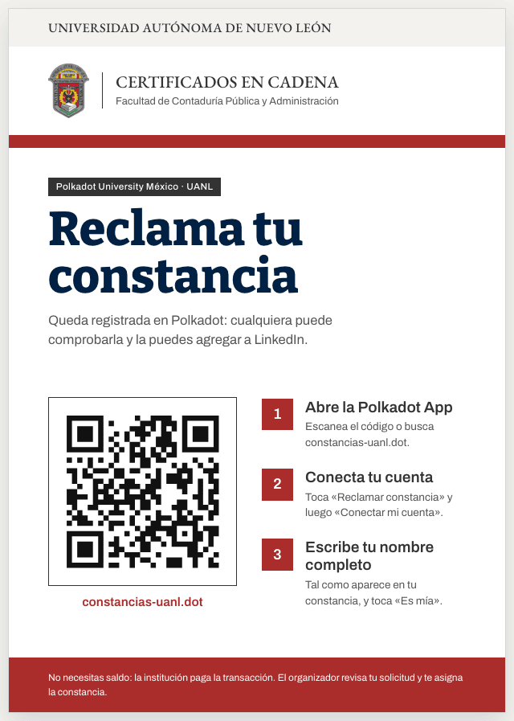</p>

### En el celular

| Inicio | Página del certificado |
|---|---|
| 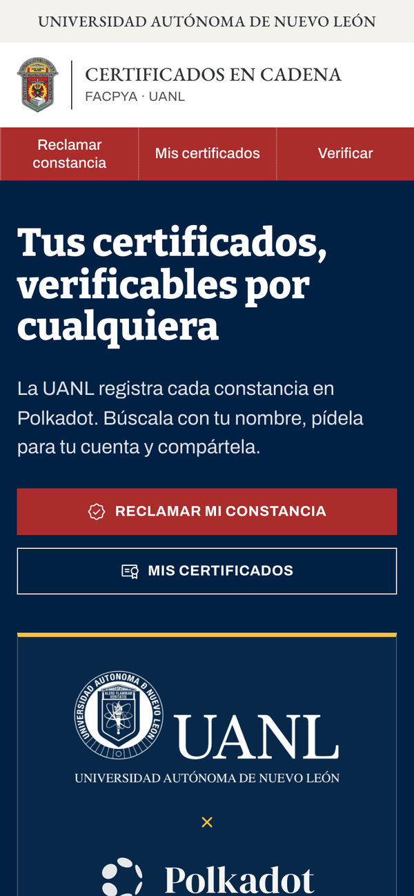 | 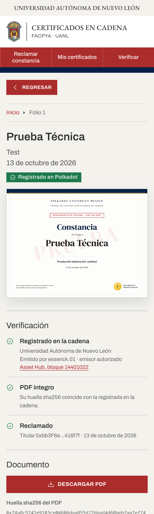 |

## Cómo funciona por dentro

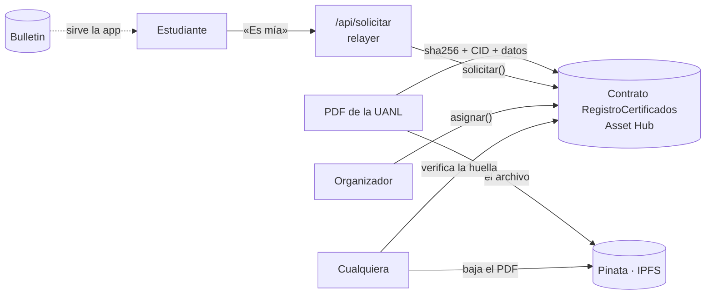

### Emisión

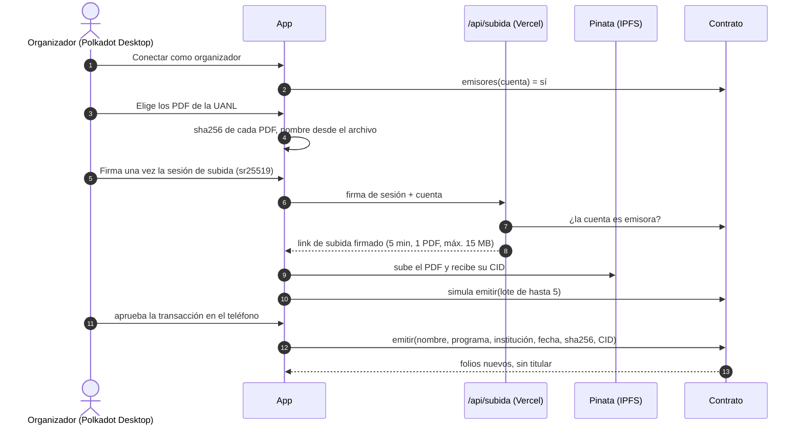

### Solicitud y aprobación

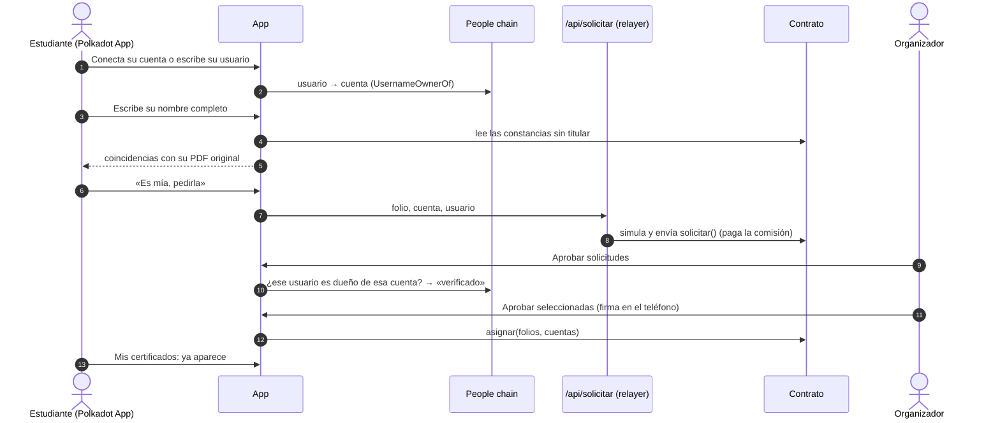

### Verificación

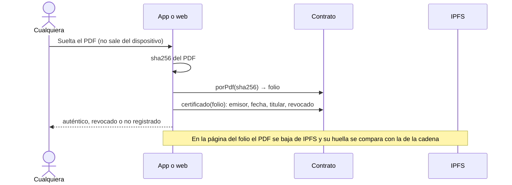

### Qué guarda la cadena

Por cada constancia, inline en el contrato (no caduca):

| Campo | Qué es |
|---|---|
| `nombre`, `programa`, `institucion`, `fecha` | Lo que dice la constancia |
| `sha256Pdf`, `cid` | Huella del PDF y dónde está en IPFS |
| `emitidoPor`, `bloque` | Cuenta emisora y bloque de Asset Hub |
| `titular`, `reclamadoEn` | Cuenta dueña (o vacío) y cuándo se asignó |
| `revocado` (+ motivo) | Si la institución la anuló |

### Por qué así

- **Bulletin borra a los 14 días** y solo el host lo lee: sirve para publicar la app, no para guardar constancias.
  Los datos van inline en el contrato y el PDF en Pinata.
- **Pedir no asigna.** El nombre de cada constancia es público; si bastara con escribirlo, cualquiera se quedaría
  con la de otro. El organizador aprueba viendo el usuario de la Polkadot App verificado en People chain.
- **La llave de Pinata nunca llega a la app.** El organizador firma una vez una sesión con su cuenta;
  `/api/subida` comprueba la firma sr25519 y que la cuenta sea emisora, y entrega un link de subida firmado
  (5 min, un PDF, máx. 15 MB).
- **El relayer no tiene permisos en el contrato.** Solo paga comisiones; simula antes de gastar.
- **Soulbound:** no existe ninguna función de transferencia. Un emisor puede reasignar (para corregir) o revocar.
- **Siempre el PDF original:** la app nunca redibuja la constancia con los datos de la cadena; muestra el PDF que
  diseñó la institución y comprueba su huella.
- **Respaldo por link:** el contrato también acepta reclamos con un código secreto (`npm run emitir` genera los
  links para correo). La firma de la llave del código fija el titular, así que copiarla de la mempool no sirve.

## Estructura

```
contract/         RegistroCertificados.sol, pruebas en EVM, deploy y prueba en PolkaVM
src/              la app (TypeScript + Vite, sin framework)
  lib/            host, cadena, contrato, organizador, IPFS, sesión, reclamo
  vistas/         inicio, constancia, organizar, certificado, mis, verificar, cartel, diagnóstico, visor del PDF
  assets/logos/   logotipos oficiales (UANL, FACPYA, Polkadot)
api/              funciones de Vercel: reclamar, solicitar, subida
tools/            CLI: emitir por lote, admin (emisores, revocar), relayer
scripts/          deploy a Bulletin con pad, ficha de la app (manifest + ícono), revisión
docs/diseno.md    sistema de diseño: lenguaje de los sitios de facultades UANL (colores, tipografía, logotipos)
docs/img/         capturas de este README
```

## Comandos

```bash
npm install && (cd contract && npm install)

npm run dev                # app + /api local en http://127.0.0.1:5175 (usa .env y .env.relayer)
npm test                   # pruebas de la app
(cd contract && npm test)  # 30 pruebas del contrato en EVM
(cd contract && npm run probar-pvm)   # dry-run en PolkaVM: instancia y ecrecover

npm run check              # revisión del build (versiones, ícono, base, peso)
npm run check-deploy       # ¿quedó todo en Bulletin y hasta cuándo? (después de publicar)
npm run admin -- emisor <usuario|SS58|0x…> [--quitar]
npm run admin -- revocar <folio> "<motivo>"   # público y sin vuelta atrás; firma el admin
npm run relayer -- estado
npm run emitir -- lotes/<lote>/lista.csv [--simulacion]   # respaldo: emisión por CLI con links por correo
```

**Web en Vercel:** cada push a `main` publica en producción (https://certificados-uanl.vercel.app). Las otras ramas
generan un preview sin secretos: el relayer y las subidas solo funcionan en producción.

Secretos (nunca en git ni en la app): `.env` (`PINATA_JWT`, `PINATA_GROUP_ID`, `PINATA_GATEWAY`) y
`.env.relayer` (frase del relayer). En Vercel: `RELAYER_SEED`, `REGISTRO_ADDRESS`, `PINATA_JWT`, `PINATA_GROUP_ID`.
`.vercelignore` es una lista blanca. `lotes/` y `salida/` (correos y códigos de reclamo) están fuera de git.

## Publicar una versión nueva

`constancias-uanl.dot` y `app.constancias-uanl.dot` son de la cuenta del organizador, no de `pad`, así que
`npm run deploy` ya no puede escribirles. La receta (probada el 3 nov 2026, la misma de la skill
`polkadot-products-devnet`, `references/publicar.md`):

1. `npm run build`.
2. Revisar que la cuenta del *pool* de `pad` tenga autorización en Bulletin (hoy `//deploy/0`).
3. Subir a un **nombre temporal** con una config propia (`domain` = el nombre temporal, `icon` = el ícono de la ficha):
   ```bash
   BULLETIN_POOL_ACCOUNT_INDEX=0 HOME="$(mktemp -d)" PAD_ENV=devnet \
     pad dist <temporal>.dot --env devnet --js-merkle --config <config-temporal>.mjs
   ```
   `pad` imprime el **CID** de la versión y el JSON de la ficha (`Verified text[manifest]`).
4. `npm run check-deploy -- --nombre <temporal>`: todas las partes en Bulletin y su fecha de caducidad.
5. En el teléfono, con la cuenta dueña: `reparador-dotns-bidc.dot` → «Apuntar versión» con el CID (cambia la raíz
   y `app.` en una firma). Si el ícono cambió: `dotns.dot` → *My Domains* → *Edit* → registro `manifest` con el JSON.
6. `npm run check-deploy` con el nombre real.

**Bulletin borra a los ~14 días:** volver a publicar antes de que caduque (lo dice `check-deploy`).

## Licencia

MIT para el código. Los logotipos de la UANL, la FACPYA y Polkadot son marcas de sus dueños y no están cubiertos
por la licencia.
